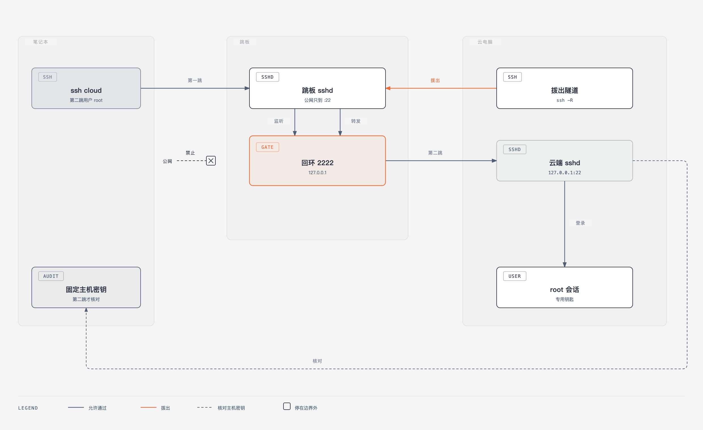
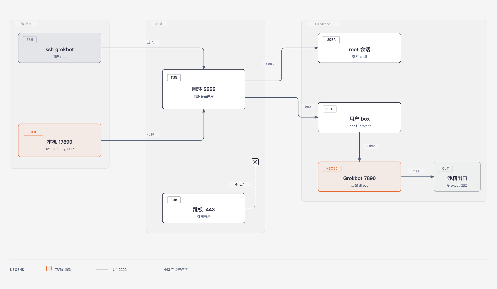
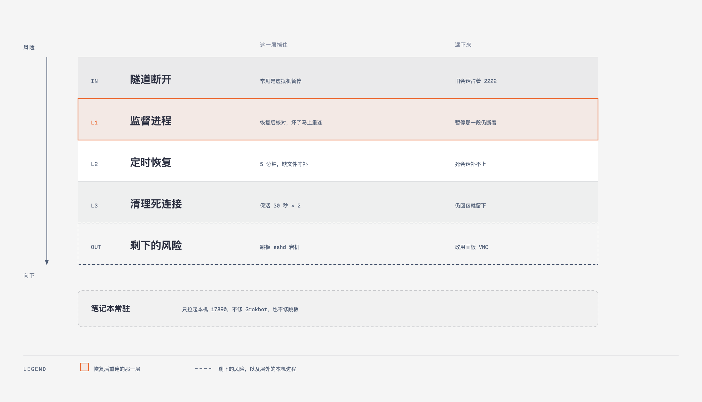

# Grokbot 没有公网 SSH，也能登录，也能当节点

Grokbot 自己拨出来，把 22 挂在跳板的回环 `2222` 上。笔记本经这条隧道登录 `root`；另一条会话把 Grokbot 的 `7890` 拉到本机 `17890`。常见断法是虚拟机被暂停，恢复后几秒重连；每一层仍有接不住的情况。

地址、指纹和文件路径没有写进来。跳板不点名。这台云电脑是 Grokbot。

排版页在 [`share.html`](share.html)，克隆后用浏览器打开。

## Grokbot 把 22 挂到跳板回环

Grokbot 上的 sshd 只听 `127.0.0.1:22`。出站是通的，所以由它主动连跳板，做一条反向转发：

```bash
ssh -N -o ExitOnForwardFailure=yes \
  -o ServerAliveInterval=15 -o ServerAliveCountMax=3 \
  -R 127.0.0.1:2222:127.0.0.1:22 jump
```

跳板因此只在自己的回环上听 `2222`，对端是 Grokbot 的 `22`。`2222` 只出现在这个回环上。防火墙上不为它开公网，转发也不绑到 `0.0.0.0`。

无人值守时加上 `BatchMode` 和 `ConnectTimeout`。拨出失败就退出，交给后面的监督进程重来。

## 第二跳才是登录，用户是 root

笔记本先用跳板那把钥匙连上跳板的 `22`。第二跳才进 Grokbot：用户是 `root`，钥匙是另一把，并核对 Grokbot 上固定的那把主机密钥。配置里的 `127.0.0.1:2222` 写的是跳板自己的回环，这一跳发生在跳板上。

拨出用第三把钥匙，只放在 Grokbot 上，用来连跳板。三把钥匙各管一段。

```sshconfig
Host jump
  HostName 跳板的公网地址
  User root
  IdentityFile ~/.ssh/id_ed25519_to_jump
  IdentitiesOnly yes

Host grokbot
  HostName 127.0.0.1
  Port 2222
  User root
  ProxyJump jump
  IdentityFile ~/.ssh/id_ed25519_to_cloud
  IdentitiesOnly yes
```



`2222` 是这张图里唯一涂了强调色的门。公网可以到跳板的 `22`，到 `2222` 的那一笔在边界前停下。

## 节点是 box 的另一条会话

同一个 `2222` 上再开一条会话，用户是 `box`。这条会话留在转发上：笔记本的 `127.0.0.1:17890` 接到 Grokbot 的 `127.0.0.1:7890`。`7890` 是 Grokbot 上的 mixed 入口，出站 direct，出口地址属于 Grokbot，流量记在 Grokbot 上。

代理客户端里它是一个 SOCKS，指向 `127.0.0.1:17890`，UDP 关掉。订阅文件里没有这一条。跳板自己的订阅端口在 `443`，流量留在跳板里，到边界就停。

```sshconfig
Host grokbot-proxy
  HostName 127.0.0.1
  Port 2222
  User box
  ProxyJump jump
  IdentityFile ~/.ssh/id_ed25519_to_cloud
  IdentitiesOnly yes
  LocalForward 127.0.0.1:17890 127.0.0.1:7890
  ExitOnForwardFailure yes
  BatchMode yes
  RequestTTY no
  ServerAliveInterval 30
  ServerAliveCountMax 6
```

测连通用 `curl --socks5-hostname`。域名在 Grokbot 上解析，本机即使指定 IPv4，结果里仍可能出现 Grokbot 的 IPv6。这段转发没写 `ConnectTimeout` 时，第二跳卡住会留下一个活着的进程，`17890` 却没有在听；这时 root 登录往往还在。要重启的是笔记本上的这段转发。



强调色只落在 `17890` 和 `7890`。`443` 和这条隧道住在同一台跳板上，中间那一笔走到边界就停。

## 保活三层，本机进程只管 17890

常见的断法是平台把 Grokbot 暂停再恢复。暂停期间 Grokbot 不发包。跳板按 30 秒 × 2 等响应，大约 90 秒后拆掉这条会话。暂停短于这 90 秒就恢复时，跳板上的旧会话还占着 `2222`，新的 `-R` 绑不上去。

监督进程大约每 20 秒走一轮，看 Grokbot 的 sshd、固定主机密钥、root 的钥匙、`7890`，以及那条 `-R`。醒来时墙钟比预期多走 30 秒以上，或者内核日志里出现新的虚拟机 fork，就当作刚恢复，一分钟内只处理一次。下一轮先核对跳板回环 `2222` 上的主机密钥。对得上就留着隧道。对不上，或者这一跳没有结果，就停掉本机 `-R`，只结束跳板上听在回环 `2222` 的那一个会话，同一轮立刻重连。从发现恢复到开始重连，测到的是 3–16 秒。检测本身落在下一轮，最多再晚大约 20 秒。暂停的那一段时间，隧道仍然是断的。

`2222` 被占住、第一次绑定失败时，同样立刻清掉那个回环会话，2 秒后再拨。其他失败要连续两次才清。跳板自己的 sshd 继续留着。

第二层每 5 分钟跑一次。启动文件缺了才补回去，再把监督进程拉起来。文件还在、会话已经死了的时候，这一层补不上。

第三层在跳板的 sshd 上。30 秒一次，连续 2 次没有响应就拆连接。对端还在回保活包时，它留着这条连接，`2222` 继续被占着。

跳板的 sshd 整个停了，三层都拨不进去。这时打开商家面板的 VNC。笔记本上另有一个常驻进程，只把 `ssh -N grokbot-proxy` 拉起来，保住本机 `17890`。Grokbot 和跳板的隧道由上面三层负责。

拨出侧的保活是 15 秒 × 3，笔记本这段转发是 30 秒 × 6，跳板 sshd 是 30 秒 × 2。三处数字各管各的连接。



强调色只在监督进程上。最底下的虚线是剩下的风险，再往下那一条虚线框在三层之外。
